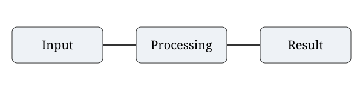

# Аннотация

Документ проверяет оформление разделов, таблиц, рисунков, формул и приложений. Используется как воспроизводимый пример для проверки конвертера.

Ключевые слова: оформление, документ, таблица, формула, приложение.

# Список используемых сокращений и терминов

API – программный интерфейс взаимодействия компонентов.

# Введение

Цель работы — проверить соответствие оформления извлечённым настройкам образца. Первый абзац после заголовка также должен иметь отступ 1,25 см.
Для этого необходимо:
1. Проверить нумерацию разделов.
2. Проверить оформление медиа.

# Литературный обзор

В обзоре приведена ссылка на будущий рисунок: @fig:second. Отдельные сведения подтверждаются источником [1].

## Исследовательский раздел

В разделе рассматривается структура данных. Сопоставление приведено в @tbl:first.

### Анализ предметной области

В этом подразделе размещены таблица и схема.

: Сравнение решений {#tbl:first}

| Решение | Функция | Результат |
|---------|---------|-----------|
| Первое | Анализ | Выполнено |
| Второе | Хранение | Выполнено |

На @fig:first показан порядок обработки запроса.

{#fig:first width=80%}

#### Дополнительный анализ

Следующая таблица в том же разделе должна продолжить нумерацию, несмотря на новый пункт.

: Дополнительные показатели {#tbl:first-more}

| Показатель | Значение |
|------------|----------|
| Время | 1 с |

Перечень характеристик:

- воспроизводимость;
- стабильность.

# Промежуточные результаты

Ненумерованный раздел не должен сбрасывать номер следующей главы.

## Аналитический раздел

Структура обработки показана на @fig:second, формула приведена как @eq:ratio.

{#fig:second width=80%}

$$
r = \frac{a}{b}
$$ {#eq:ratio}

где $a$ — число успешных операций;

$b$ — общее число операций.

### Методы решения

Безымянные подписи также получают номер.

: Характеристики метода

| Параметр | Значение |
|----------|----------|
| Проверка | Успешно |

## Технологический раздел

Пример программного фрагмента без специальной подписи:

```python
print("Проверка")
```

# Заключение

Проверены основные элементы оформления. Ссылки на @tbl:first-more и @eq:ratio сохраняют свои номера.

# Список использованных источников

1. Пример источника. Название. — 2026.
2. Второй источник. Название. — 2026.

# Приложения

Приложение А — дополнительные материалы.

# Приложение А

::: {custom-style="Appendix Title"}
Дополнительные материалы
:::

Таблица приложения представлена как @tbl:appendix; схема — @fig:appendix.

: Данные приложения {#tbl:appendix}

| Название | Значение |
|----------|----------|
| Проверка | Выполнено |

{#fig:appendix width=70%}

$$ a + b = c $$ {#eq:appendix}

где $c$ — итоговое значение.


```
Листинг А.1 – Проверочный модуль
print("Строка 1")
print("Строка 2")
print("Строка 3")
print("Строка 4")
print("Строка 5")
print("Строка 6")
print("Строка 7")
print("Строка 8")
print("Строка 9")
print("Строка 10")
print("Строка 11")
print("Строка 12")
print("Строка 13")
print("Строка 14")
print("Строка 15")
print("Строка 16")
print("Строка 17")
print("Строка 18")
print("Строка 19")
print("Строка 20")
print("Строка 21")
print("Строка 22")
print("Строка 23")
print("Строка 24")
print("Строка 25")
print("Строка 26")
print("Строка 27")
print("Строка 28")
print("Строка 29")
print("Строка 30")
print("Строка 31")
print("Строка 32")
print("Строка 33")
print("Строка 34")
print("Строка 35")
print("Строка 36")
print("Строка 37")
print("Строка 38")
print("Строка 39")
print("Строка 40")
print("Строка 41")
print("Строка 42")
print("Строка 43")
print("Строка 44")
print("Строка 45")
print("Строка 46")
print("Строка 47")
print("Строка 48")
print("Строка 49")
print("Строка 50")
print("Строка 51")
print("Строка 52")
print("Строка 53")
print("Строка 54")
print("Строка 55")
print("Строка 56")
print("Строка 57")
print("Строка 58")
print("Строка 59")
print("Строка 60")
print("Строка 61")
print("Строка 62")
print("Строка 63")
print("Строка 64")
print("Строка 65")
print("Строка 66")
print("Строка 67")
print("Строка 68")
print("Строка 69")
print("Строка 70")
print("Строка 71")
print("Строка 72")
print("Строка 73")
print("Строка 74")
print("Строка 75")
print("Строка 76")
print("Строка 77")
print("Строка 78")
print("Строка 79")
print("Строка 80")
print("Строка 81")
print("Строка 82")
print("Строка 83")
print("Строка 84")
print("Строка 85")
print("Строка 86")
print("Строка 87")
print("Строка 88")
print("Строка 89")
print("Строка 90")
```

# Приложение Б

::: {custom-style="Appendix Title"}
Широкие материалы
:::

::: {.landscape}

: Длинная таблица {#tbl:wide}

| Номер | Входные данные | Ожидаемый результат | Полученный результат | Статус |
|---|---|---|---|---|
| 1 | Запрос 1 | Данные сохранены | Данные сохранены | Выполнено |
| 2 | Запрос 2 | Данные сохранены | Данные сохранены | Выполнено |
| 3 | Запрос 3 | Данные сохранены | Данные сохранены | Выполнено |
| 4 | Запрос 4 | Данные сохранены | Данные сохранены | Выполнено |
| 5 | Запрос 5 | Данные сохранены | Данные сохранены | Выполнено |
| 6 | Запрос 6 | Данные сохранены | Данные сохранены | Выполнено |
| 7 | Запрос 7 | Данные сохранены | Данные сохранены | Выполнено |
| 8 | Запрос 8 | Данные сохранены | Данные сохранены | Выполнено |
| 9 | Запрос 9 | Данные сохранены | Данные сохранены | Выполнено |
| 10 | Запрос 10 | Данные сохранены | Данные сохранены | Выполнено |
| 11 | Запрос 11 | Данные сохранены | Данные сохранены | Выполнено |
| 12 | Запрос 12 | Данные сохранены | Данные сохранены | Выполнено |
| 13 | Запрос 13 | Данные сохранены | Данные сохранены | Выполнено |
| 14 | Запрос 14 | Данные сохранены | Данные сохранены | Выполнено |
| 15 | Запрос 15 | Данные сохранены | Данные сохранены | Выполнено |
| 16 | Запрос 16 | Данные сохранены | Данные сохранены | Выполнено |
| 17 | Запрос 17 | Данные сохранены | Данные сохранены | Выполнено |
| 18 | Запрос 18 | Данные сохранены | Данные сохранены | Выполнено |
| 19 | Запрос 19 | Данные сохранены | Данные сохранены | Выполнено |
| 20 | Запрос 20 | Данные сохранены | Данные сохранены | Выполнено |
| 21 | Запрос 21 | Данные сохранены | Данные сохранены | Выполнено |
| 22 | Запрос 22 | Данные сохранены | Данные сохранены | Выполнено |
| 23 | Запрос 23 | Данные сохранены | Данные сохранены | Выполнено |
| 24 | Запрос 24 | Данные сохранены | Данные сохранены | Выполнено |
| 25 | Запрос 25 | Данные сохранены | Данные сохранены | Выполнено |
| 26 | Запрос 26 | Данные сохранены | Данные сохранены | Выполнено |
| 27 | Запрос 27 | Данные сохранены | Данные сохранены | Выполнено |
| 28 | Запрос 28 | Данные сохранены | Данные сохранены | Выполнено |
| 29 | Запрос 29 | Данные сохранены | Данные сохранены | Выполнено |
| 30 | Запрос 30 | Данные сохранены | Данные сохранены | Выполнено |
| 31 | Запрос 31 | Данные сохранены | Данные сохранены | Выполнено |
| 32 | Запрос 32 | Данные сохранены | Данные сохранены | Выполнено |
| 33 | Запрос 33 | Данные сохранены | Данные сохранены | Выполнено |
| 34 | Запрос 34 | Данные сохранены | Данные сохранены | Выполнено |
| 35 | Запрос 35 | Данные сохранены | Данные сохранены | Выполнено |
| 36 | Запрос 36 | Данные сохранены | Данные сохранены | Выполнено |
| 37 | Запрос 37 | Данные сохранены | Данные сохранены | Выполнено |
| 38 | Запрос 38 | Данные сохранены | Данные сохранены | Выполнено |
| 39 | Запрос 39 | Данные сохранены | Данные сохранены | Выполнено |
| 40 | Запрос 40 | Данные сохранены | Данные сохранены | Выполнено |
| 41 | Запрос 41 | Данные сохранены | Данные сохранены | Выполнено |
| 42 | Запрос 42 | Данные сохранены | Данные сохранены | Выполнено |
| 43 | Запрос 43 | Данные сохранены | Данные сохранены | Выполнено |
| 44 | Запрос 44 | Данные сохранены | Данные сохранены | Выполнено |
| 45 | Запрос 45 | Данные сохранены | Данные сохранены | Выполнено |
| 46 | Запрос 46 | Данные сохранены | Данные сохранены | Выполнено |
| 47 | Запрос 47 | Данные сохранены | Данные сохранены | Выполнено |
| 48 | Запрос 48 | Данные сохранены | Данные сохранены | Выполнено |
| 49 | Запрос 49 | Данные сохранены | Данные сохранены | Выполнено |
| 50 | Запрос 50 | Данные сохранены | Данные сохранены | Выполнено |
| 51 | Запрос 51 | Данные сохранены | Данные сохранены | Выполнено |
| 52 | Запрос 52 | Данные сохранены | Данные сохранены | Выполнено |
| 53 | Запрос 53 | Данные сохранены | Данные сохранены | Выполнено |
| 54 | Запрос 54 | Данные сохранены | Данные сохранены | Выполнено |
| 55 | Запрос 55 | Данные сохранены | Данные сохранены | Выполнено |
| 56 | Запрос 56 | Данные сохранены | Данные сохранены | Выполнено |
| 57 | Запрос 57 | Данные сохранены | Данные сохранены | Выполнено |
| 58 | Запрос 58 | Данные сохранены | Данные сохранены | Выполнено |
| 59 | Запрос 59 | Данные сохранены | Данные сохранены | Выполнено |
| 60 | Запрос 60 | Данные сохранены | Данные сохранены | Выполнено |
| 61 | Запрос 61 | Данные сохранены | Данные сохранены | Выполнено |
| 62 | Запрос 62 | Данные сохранены | Данные сохранены | Выполнено |
| 63 | Запрос 63 | Данные сохранены | Данные сохранены | Выполнено |
| 64 | Запрос 64 | Данные сохранены | Данные сохранены | Выполнено |
| 65 | Запрос 65 | Данные сохранены | Данные сохранены | Выполнено |
| 66 | Запрос 66 | Данные сохранены | Данные сохранены | Выполнено |
| 67 | Запрос 67 | Данные сохранены | Данные сохранены | Выполнено |
| 68 | Запрос 68 | Данные сохранены | Данные сохранены | Выполнено |
| 69 | Запрос 69 | Данные сохранены | Данные сохранены | Выполнено |
| 70 | Запрос 70 | Данные сохранены | Данные сохранены | Выполнено |
| 71 | Запрос 71 | Данные сохранены | Данные сохранены | Выполнено |
| 72 | Запрос 72 | Данные сохранены | Данные сохранены | Выполнено |
| 73 | Запрос 73 | Данные сохранены | Данные сохранены | Выполнено |
| 74 | Запрос 74 | Данные сохранены | Данные сохранены | Выполнено |
| 75 | Запрос 75 | Данные сохранены | Данные сохранены | Выполнено |

:::

Возврат к книжной ориентации после широкой таблицы.
